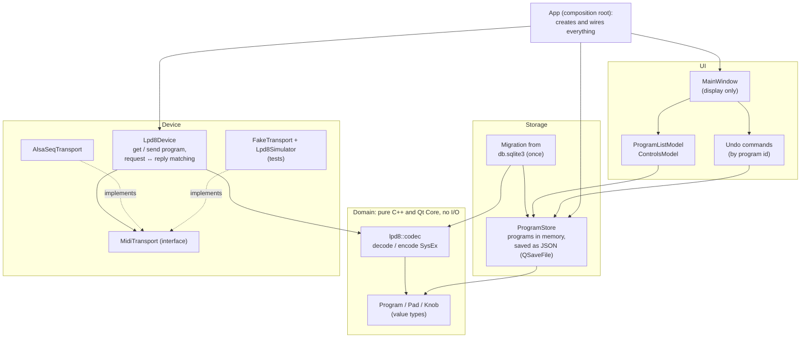

# Architecture

This document describes where the architecture rework (phase 4 of
`doc/IMPROVEMENTS.md`) is going, and why. It is written before the code, so you
can review the design without reading a diff.

## The problem with the current structure

Before this rework (until item 4.7b removed the SQLite code), knowledge
about the LPD8 was spread across every layer. This section keeps the
description of that structure, since it explains the target:

- The SysEx byte layout is implied by the **order of SQL columns**
  (`select note, pc, cc, toggle`), in `db.cpp`.
- The default values live in an **SQL trigger**.
- The number of device slots (4) is hard-coded in `mainwindow.cpp`,
  `sysexhandler.cpp` and `lpd8_sysex.cpp`.
- `ProgramsModel` turns three SQL tables into a tree with a forest of
  `QSortFilterProxyModel`s (three per program), and it resets completely when
  a program is created or deleted.
- Every class reaches the same global undo stack and the same default database
  connection, so nothing can be tested or reused alone.

As a result, a small change (for example supporting the LPD8 Mk2, issue #49)
touches every file, and the most important logic, the SysEx encoding, can only
be tested through a database.

## The target



The arrows show dependencies. The rule is that dependencies point *inward*:
the domain depends on nothing, and storage, device and UI depend on the domain,
never on each other. Only `App` knows everything, and its only job is to
connect the pieces.

### Domain: `Program` and the codec

```cpp
namespace lpd8 {
struct Pad  { quint8 note, programChange, controlChange; bool toggle; };
struct Knob { quint8 controlChange, low, high; };
struct Program {
    quint8 channel;
    std::array<Pad, 8> pads;
    std::array<Knob, 8> knobs;
};
}
```

`Program` is a *value type*: it is copied, compared with `==`, and has no
identity or behaviour. It holds what the device stores and nothing else, so
two programs are equal exactly when the device would behave the same with
either. The name the user gives a program is not device content: the store
keeps it next to the program's id. Value types are easy to reason about and to test. An
undo step can simply keep the program as it was before the edit.

The codec turns a `Program` into SysEx bytes and back. It is a set of pure
functions with no I/O:

- `decodeProgram()` returns `std::expected<DecodedProgram, DecodeError>`: the
  program and the device slot named in the message, or the kind of error and
  the position of the byte at fault, so the user can be told which value is
  wrong. A caller can't forget that decoding can fail.
- `encodeGetProgram()` and `encodeSendProgram()` build the messages that go to
  the device, and refuse (`std::expected<QByteArray, EncodeError>`) an invalid
  slot or program rather than send malformed MIDI.
- `encodeStoredProgram()` builds the format the application stores and
  exports (doc/SYSEX.md, "Storage format").

The byte offsets of `doc/SYSEX.md` belong in this one file. The database layer
already goes through it. The MIDI path's older helpers (`lpd8_sysex.cpp`) move
to it in item 4.10, and then it is the only place. Supporting another device
means writing another codec, not editing the database code.

### Storage: `ProgramStore`

The store keeps the programs in memory, each with a stable integer id, and
saves them to one human-readable JSON file:

```json
{
    "format": 1,
    "programs": [
        { "id": 1, "name": "Drums", "channel": 9,
          "pads":  [ { "note": 36, "programChange": 1, "controlChange": 48, "toggle": false }, ... ],
          "knobs": [ { "controlChange": 16, "low": 0, "high": 127 }, ... ] }
    ]
}
```

Why JSON instead of SQLite: the data is a few kilobytes and is always loaded
completely. A database brings a schema, triggers, transactions and an
`ORDER BY` for things that a `QList<Program>` gives for free. `QSaveFile` writes
the file atomically: a crash in the middle of a save leaves the previous
version intact. The `format` number allows the file format to change later.

The store is a `QObject` that signals `programAdded`, `programRemoved` and
`programChanged(id)`. The models listen to those signals instead of being reset.

**Migration**: on the first start of the new version, if the JSON file doesn't
exist but `db.sqlite3` does, its programs are read once, read-only (by
`migration.cpp`, which checks every value), and saved as JSON. The old file is
renamed to `db.sqlite3.migrated` and kept as a backup, with the migration's
report next to it. QtSql is only used by this migration.

### UI: models and undo

- `ProgramListModel`: a `QAbstractListModel` of program names, for the list on
  the left. Renaming edits the name.
- `ControlsModel`: a `QAbstractTableModel` of the pads (or the knobs) of *one*
  program, which the window points at the selected program. This replaces the
  tree of proxies: two flat models, with no internal pointers and no resets.

Every edit is an undo command that knows the **program id** and the program's
value before and after. Undo writes the old value back. Since the command holds
an id and two values, never a pointer into a model, it stays valid whatever
happens to the models (the use-after-free fixed in item 3.13 can't come back).
The undo stack belongs to `App` and is passed to whoever needs it, instead of
being found through `qApp`.

### Device: `MidiTransport` and `Lpd8Device`

`MidiTransport` is an interface: send a SysEx message, receive SysEx messages,
list the ports, connect to one, and be told when ports come and go.
`AlsaSeqTransport` implements it with the ALSA sequencer (what was `IOMidi`,
and the ALSA half of `MidiConnectionsModel`, until item 4.8b). PipeWire bridges ALSA sequencer clients, and
JACK sees them through pipewire-jack or a2jmidid, so this one backend reaches
the usual Linux audio setups. Another backend can be added behind the same
interface later.

`Lpd8Device` speaks the LPD8 protocol on top of a transport:

- `requestProgram(slot)` sends a 'get program' message and waits for the reply
  **for that slot**, with a timeout. The reply becomes a `Program` through the
  codec. Today, any program dump that arrives, whether requested or not, and
  from any client, overwrites the selected program. That was the security
  finding of the review.
- `sendProgram(slot, program)` encodes and sends a program.

A `FakeTransport` with an `Lpd8Simulator` behind it answers like a real LPD8,
so the device protocol is tested without hardware, on CI machines too.

### `App`: the composition root

`App` creates the store, the undo stack, the transport, the device and the
window, connects them, and owns them. `MainWindow` receives what it displays
and the commands it can run, and contains no setup logic. That makes the window
much smaller, and every other piece testable on its own.

## Migration order

Each step is one commit, and the application keeps working after each one:

1. **Domain types** (4.1) and the **codec** (4.2), with tests. Nothing uses
   them yet.
2. **`ProgramStore`** (4.3) and the **migration** (4.4), with tests.
3. **New models and commands** (4.5, 4.6) with tests, then the switch of
   `MainWindow` to them.
4. **Removal** of the SQLite schema, `db.cpp` (except the migration reader),
   `ProgramsModel` and the old commands (4.7).
5. **Transport** (4.8), **simulator** (4.9) and **`Lpd8Device`** (4.10), then
   the switch of the MIDI menu to them.
6. **`App`** (4.11): the wiring moves out of `MainWindow`.

While old and new code live side by side, the new code goes into new files, so
each commit is easy to read.
