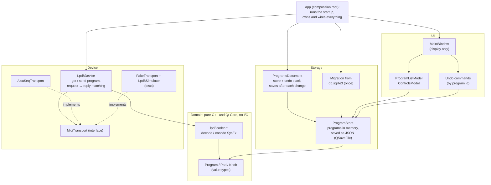

# Architecture

This document describes how lpd8editor is built, and why. The design came
out of a rework of the original code (phase 4 of `doc/IMPROVEMENTS.md`,
where each step and its commit are recorded); the last section says what it
replaced.

## Overview



The arrows show dependencies. The rule is that dependencies point *inward*:
the domain depends on nothing, and storage, device and UI depend on the domain,
never on each other. Only `App` knows everything, and its job is to run the
startup and connect the pieces.

The code is in `src/`. Everything except `main.cpp` builds into the
`lpd8editor-lib` static library, so the tests in `tests/` link exactly the
code the application runs.

### Domain: `Program` and the codec

```cpp
namespace lpd8 {
struct Pad  { quint8 note, programChange, controlChange; bool toggle; };
struct Knob { quint8 controlChange, low, high; };
struct Program {
    quint8 channel;
    std::array<Pad, 8> pads;
    std::array<Knob, 8> knobs;
};
}
```

`Program` is a *value type*: it is copied, compared with `==`, and has no
identity or behaviour. It holds what the device stores and nothing else, so
two programs are equal exactly when the device would behave the same with
either. The name the user gives a program is not device content: the store
keeps it next to the program's id. Value types are easy to reason about and to test. An
undo step can simply keep the program as it was before the edit.

The codec turns a `Program` into SysEx bytes and back. It is a set of pure
functions with no I/O:

- `decodeProgram()` returns `std::expected<DecodedProgram, DecodeError>`: the
  program and the device slot named in the message, or the kind of error and
  the position of the byte at fault, so the user can be told which value is
  wrong. A caller can't forget that decoding can fail.
- `encodeGetProgram()` and `encodeSendProgram()` build the messages that go to
  the device, and refuse (`std::expected<QByteArray, EncodeError>`) an invalid
  slot or program rather than send malformed MIDI.
- `encodeStoredProgram()` builds the format the application stores and
  exports (doc/SYSEX.md, "Storage format").

The byte offsets of `doc/SYSEX.md` are in this one file (`lpd8codec.*`), the
only place that knows them: program files and `Lpd8Device` go through it
(the migration builds programs from the old database's columns, not from
SysEx). `DeviceProfile` holds the device slots and the factory
program. Supporting another device means writing
another codec.

### Storage: `ProgramStore`

The store keeps the programs in memory, each with a stable integer id, and
saves them to one human-readable JSON file:

```json
{
    "format": 1,
    "nextId": 2,
    "programs": [
        { "id": 1, "name": "Drums", "channel": 9,
          "pads":  [ { "note": 36, "programChange": 1, "controlChange": 48, "toggle": false }, ... ],
          "knobs": [ { "controlChange": 16, "low": 0, "high": 127 }, ... ] }
    ]
}
```

Why JSON instead of SQLite: the data is a few kilobytes and is always loaded
completely. A database brings a schema, triggers, transactions and an
`ORDER BY` for things that a `QList<Program>` gives for free. `QSaveFile` writes
the file atomically: a crash in the middle of a save leaves the previous
version intact. The `format` number allows the file format to change later.

Ids are never handed out twice, not even across sessions (`nextId`), so an id
remembered anywhere can't come to name another program. Reading is strict: an
unknown key, or a value out of range, makes the file unreadable rather than
being dropped at the next save. A file that can't be loaded is never
overwritten; its error has a kind (`LoadError`: can't be read, damaged, or
written by a newer version), which decides what the startup offers.

The store is a `QObject` that signals each change before and after it
(`programAdded`, `programRemoved`, `programChanged`, `nameChanged`, and a
reset around `load()`), with the program's row. The models listen to those
signals instead of being reset.

`ProgramsDocument` holds the store and its undo stack, and saves: after each
change of the store, coalesced so that one turn of the event loop makes one
write, with a failure reported once until a save succeeds again. The final
save (closing, quitting, the session ending) is `saveFinal()`, which returns
the error to `App`, since what can be shown depends on the moment.

Program files (`.lpd8`, import and export) are read and written by
`programfile.*`, in the storage format of the codec.

**Migration**: on the first start of the new version, if the JSON file doesn't
exist but `db.sqlite3` does, its programs are read once, read-only (by
`migration.cpp`, which checks every value), and saved as JSON. The old file is
renamed to `db.sqlite3.migrated` and kept as a backup, with the migration's
report next to it. QtSql is only used by this migration.

### UI: models and undo

- `ProgramListModel` (`programmodels.*`): the programs, one row each (name
  and MIDI channel), for the list on the left and the channel box. Renaming
  edits the name.
- `ControlsModel`: a table of the pads (or the knobs) of *one* program, which
  the window points at the selected program. Two flat models, with no
  internal pointers and no resets.
- `MidiValueDelegate` edits their values (note names, channels, toggle) in
  the views.

Every edit is an undo command (`storecommands.*`: set a program, rename,
add, remove) that knows the **program id** and the program's
value before and after. Undo writes the old value back. Since the command holds
an id and two values, never a pointer into a model, it stays valid whatever
happens to the models (the use-after-free fixed in item 3.13 can't come back).
A command whose program is gone marks itself obsolete. The undo stack belongs
to `ProgramsDocument`, which `App` owns, and is passed to whoever needs it,
instead of being found through `qApp`. It is cleared when the store is
reloaded, since ids only mean something for the content they were made
against.

### Device: `MidiTransport` and `Lpd8Device`

`MidiTransport` is an interface: send a SysEx message, receive SysEx messages,
list the ports, connect to one, and be told when ports come and go.
`AlsaSeqTransport` implements it with the ALSA sequencer; it alone includes
`asoundlib.h`, behind a pimpl, and reassembles received SysEx per source with
`SysexAssembler`. PipeWire bridges ALSA sequencer clients, and JACK sees them
through pipewire-jack or a2jmidid, so this one backend reaches the usual Linux
audio setups. Another backend can be added behind the same interface later.
`MidiConnectionsModel` lists the transport's ports for the connection box.

`Lpd8Device` speaks the LPD8 protocol on top of a transport:

- `requestProgram(slot)` sends a 'get program' message and waits for the reply
  **for that slot**, with a timeout of 2 seconds. One request is in flight at
  a time; others wait in order.
- `sendProgram(slot, program)` encodes and sends a program, which has no
  reply.
- A reply is accepted only if it is a program dump for the slot asked for,
  from a port the application receives from, read at that moment (never a
  remembered id: a replugged device gets a new one). With the connection made
  in lpd8editor, that is the device; with connections made by another tool,
  any port patched into the application. Everything else is ignored and
  counted. This rule resolved a security finding of the review: before it,
  any program dump that arrived, requested or not and from any client,
  overwrote the selected program.
- The window fixes the target program when the user asks (the reply goes
  there, whatever is selected when it arrives), turns the MIDI actions off
  while a request is in flight, and shows failures in one non-modal box.

A `FakeTransport` with an `Lpd8Simulator` behind it answers like a real LPD8,
so the device protocol is tested without hardware, on CI machines too.

### `App`: the composition root

`App` (`src/app.h`) runs the startup, then owns what the application is made
of. `main()` is only `QApplication`, `App`, `start()` and `exec()`.

- **Startup.** `start()` migrates the old database if needed and loads the
  programs file. When either fails, it asks the user what fits the failure
  (Retry a migration, Set aside a damaged file, or only Quit), through the
  `AppDialogs` interface: modal message boxes in the application, a fake in
  the tests. Nothing is written unless the user picks an action that writes.
- **Ownership.** `App` holds, in this order, the document (the store and its
  undo stack), the transport, the device and the window, so they are
  destroyed window first. `MainWindow(document, transport, device)` uses them
  and owns none; it keeps only view state, such as the program a pending
  request is for.
- **Saving.** The document saves after each change; a failure goes to the
  window's one non-modal problem box, as MIDI failures do. The final save is
  `App`'s, because each moment allows a different message: when the window
  closes, a failure asks "Close without saving" or "Cancel"; at quit, a
  modal message is all that is left; when the session ends, the failure is
  shown only if the session manager allows asking (`SessionEnd`), and logged
  otherwise.
- **Testing.** What `App` depends on is injected (`App::Options`): the paths,
  the dialogs, a transport factory, the clock, the migration. `app_test`
  runs every startup branch and every final save through `App`.

## What this design replaced

Until the rework, knowledge about the LPD8 was spread across every layer:
the SysEx byte layout was implied by the order of SQL columns in `db.cpp`,
the default values lived in an SQL trigger, the number of device slots was
hard-coded in three files, `ProgramsModel` turned three SQLite tables into a
tree of `QSortFilterProxyModel`s that reset on every change, and every class
reached the same global undo stack and database connection. A small change,
such as supporting the LPD8 Mk2 (issue #49), touched every file, and the
SysEx encoding could only be tested through a database.

The rework replaced that structure step by step, with the application
working after each commit. `doc/IMPROVEMENTS.md` (phase 4) records the
steps, their reasons, and their commits. The only part of the old storage
left is the one-time migration from `db.sqlite3`, which item 5.4 removes
once no supported upgrade path needs it.
